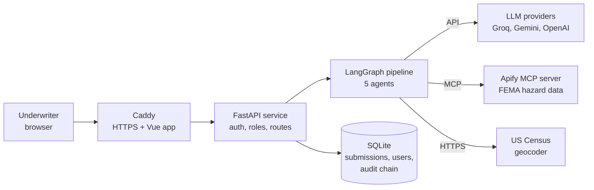
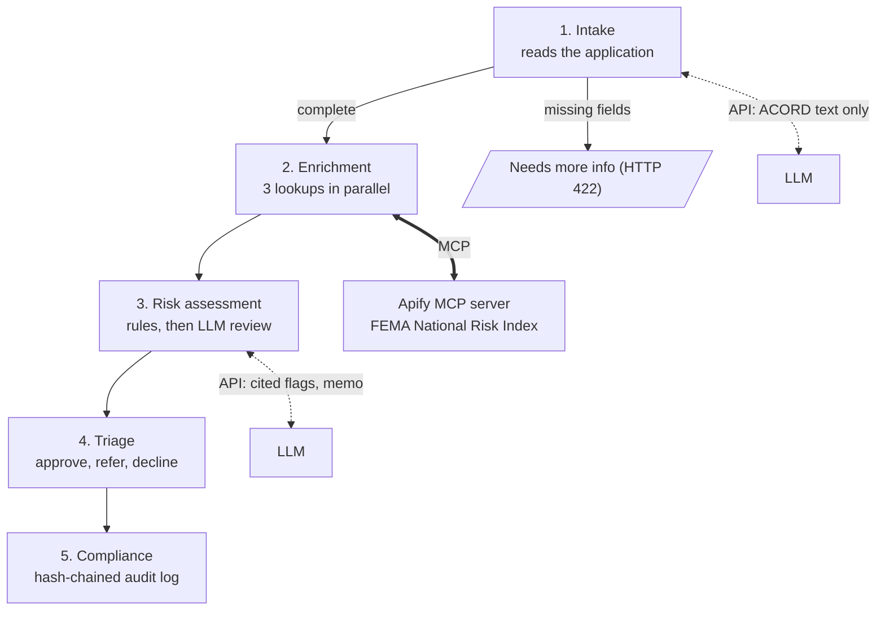
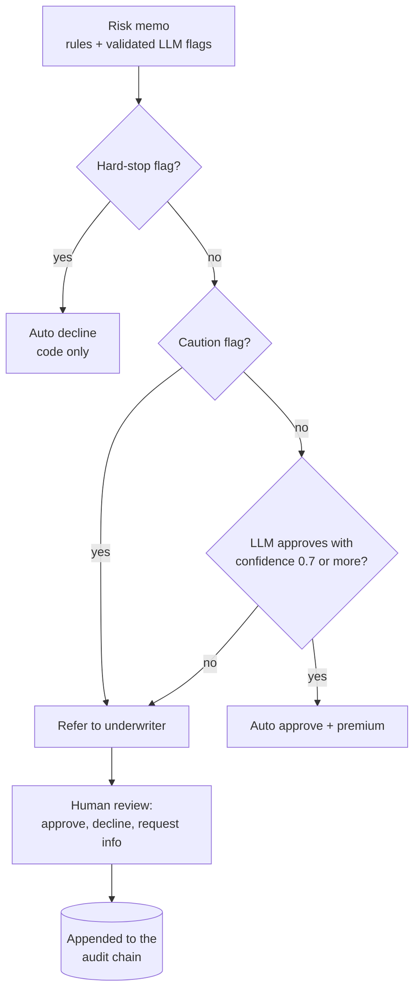
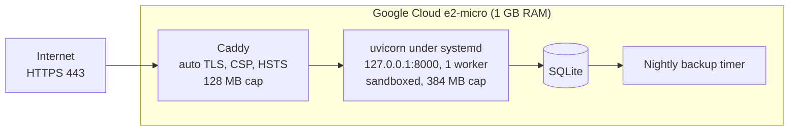

# Homeowners Underwriting Agent

An agentic underwriting workflow for homeowners insurance. Five LangGraph agents read a
submission, enrich it with live hazard data over **MCP**, apply deterministic underwriting
rules, add a guardrailed LLM review, and approve, decline or refer the case to a human
underwriter. Every decision is written to a tamper-evident, hash-chained audit log.

> **Design rule:** the LLM can make a decision *more cautious, never less*. Declines come only
> from code-enforced hard-stop rules; the LLM can add cited flags or recommend a referral, but
> it cannot decline, and it cannot approve past a rule flag.

All applicant data is synthetic. Loss history, property data and the premium are mocked.

## Contents

[Architecture](#architecture) · [Agent flow](#agent-flow-and-mcp) · [Decision flow](#decision-flow) ·
[Deployment](#deployment) · [Source structure](#source-code-structure) · [Tech stack](#tech-stack) ·
[Quick start](#quick-start) · [Samples](#sample-submissions) · [Evaluation](#evaluation) ·
[Security](#security-and-guardrails) · [Limitations](#limitations-and-roadmap)

## Architecture



## Agent flow and MCP



Only the Enrichment agent uses MCP. A failed hazard lookup never falls back to mock scores: the
result is marked unavailable and rule HZ-002 refers the case.

## Decision flow



A referral waits for a signed-in underwriter. Their review is appended to the audit log; the
automated decision stays in the chain unchanged.

## Deployment



One free-tier VM without Docker: the API runs as a sandboxed systemd service, Caddy serves the
Vue workbench and proxies `/api`, and CI checks peak memory against the VM budget. Step-by-step
instructions are in [deploy/README.md](deploy/README.md).

## Source code structure

```
src/underwriting_agent/
  api/            FastAPI app and routes
  agents/         intake, enrichment, risk_assessment, triage, compliance
  graph/          LangGraph StateGraph (builder.py) and runner (orchestrator.py)
  llm/            provider client with ordered fallback and retries
  tools/          hazard_apify (MCP), mocked loss history, property data and rating
  auth/           sign-in, sessions, roles, password hashing
  persistence/    SQLAlchemy models and repository (SQLite, hash-chained log)
  schemas/        Pydantic models shared by agents and API
  evals/          38 labelled cases and the scorecard runner
  samples/        five synthetic submissions
  rules.py        thresholds and the rule catalogue
frontend/         Vue 3 underwriter workbench (queue, submission detail, review)
deploy/           install script, systemd units, Caddyfile, backups
tests/            195 backend tests (fakes only)
docs/             detailed documentation and the architecture and security review PDF
```

## Tech stack

| Layer | Implementation |
| --- | --- |
| Orchestration | LangGraph `StateGraph` with conditional routing and parallel fan-out |
| API | FastAPI, Pydantic v2, async SQLAlchemy over SQLite |
| LLMs | Groq, Gemini, OpenAI behind one client with fallback and retry |
| Tools and data | MCP (Apify server) for FEMA National Risk Index, US Census geocoder |
| Front end | Vue 3, Vite, TypeScript, Vitest |
| Delivery | GitHub Actions CI, systemd, Caddy |

## Quick start

No API keys are needed for the structured samples when hazard data is mocked.

```bash
uv sync
cp .env.example .env            # then set HAZARD_PROVIDER=mock
uv run uvicorn underwriting_agent.api.main:app --reload
uv run python -m underwriting_agent.auth create --username ada --name "Ada L" --role admin
```

Open http://localhost:8000/docs, sign in, and try `POST /underwrite` with a sample. Start the
workbench in a second terminal:

```bash
cd frontend && npm install && npm run dev      # http://localhost:5173
```

On Windows, `scripts\dev.ps1` starts both. Add `GROQ_API_KEY`, `GEMINI_API_KEY` or
`OPENAI_API_KEY` to read raw ACORD text, and `APIFY_TOKEN` for live hazard data (about $0.006
per submission).

## Sample submissions

| Sample | Result | Why |
| --- | --- | --- |
| clean | Approved | No caution or hard-stop flags |
| high_risk | Referred | Pool, trampoline, three claims, high-hazard ZIP |
| decline | Declined | Roof older than 25 years (HS-001) |
| incomplete | Needs more info (422) | Coverage A missing |
| acord_text | Referred | The LLM reads the text; the pool triggers SR-010 |

## Evaluation

38 synthetic cases, including boundary cases (a roof exactly 25 years old, a hazard score of
exactly 70). Results from 29 September 2026 (Groq `openai/gpt-oss-120b`):

| Run | Accuracy | Unsafe approvals | Over-referrals |
| --- | --- | --- | --- |
| Rules only | 28/38 | 10 | 0 |
| Rules + LLM, run 1 | 38/38 | 0 | 0 |
| Rules + LLM, run 2 | 38/38 | 0 | 0 |
| Rules + LLM, run 3 | 35/38 | 0 | 3 |

There were **0 unsafe approvals in 114 LLM decisions**. The labels are the author's own
synthetic judgments, and run 3 shows some model inconsistency; see the details document. The
rules-only gate and the 195 tests run in CI on every push.

```bash
uv run pytest
uv run python -m underwriting_agent.evals --gate
```

## Security and guardrails

- **Bounded LLM:** only catalogue rules can be raised, each must cite a field that exists, and
  invalid output falls back to rules only. The LLM cannot decline or approve past a flag.
- **Evidence for extraction:** every value read from ACORD text needs a verbatim quote that is
  checked against the source text.
- **Access control:** sign-in, three roles (viewer, underwriter, admin), session cookies and
  lockout after repeated failures. The reviewer is always taken from the session.
- **Audit:** a SHA-256 hash chain over every decision, checked by `GET /audit/verify` and shown
  in the workbench.
- **Secrets:** none are committed; keys are held as secret values and `.env` is ignored.
- **Hosting:** localhost-only API behind Caddy, systemd sandboxing, CSP and HSTS headers.

The full review, with an OWASP mapping and a list of known gaps, is in
[docs/Underwriting_Agent_Architecture_and_Review.pdf](docs/Underwriting_Agent_Architecture_and_Review.pdf).

## Limitations and roadmap

- Loss history, property data and the premium are mocked, and the evaluation labels are
  self-authored.
- No SAST, dependency or secret scanning in CI yet; no request-size cap or rate limit on
  `/underwrite`; the login lockout is per process; submissions are stored unencrypted.
- The audit chain is tamper-evident, not tamper-proof; anchoring the latest hash somewhere
  immutable would close that.
- Next: security scanning in CI, rate limiting, real data sources, and an AWS version.

## More detail

[docs/DETAILS.md](docs/DETAILS.md) has the full reference: every endpoint, the rule catalogue,
the audit log design, the provider comparison, sign-in and review behaviour, and the build
phases.
